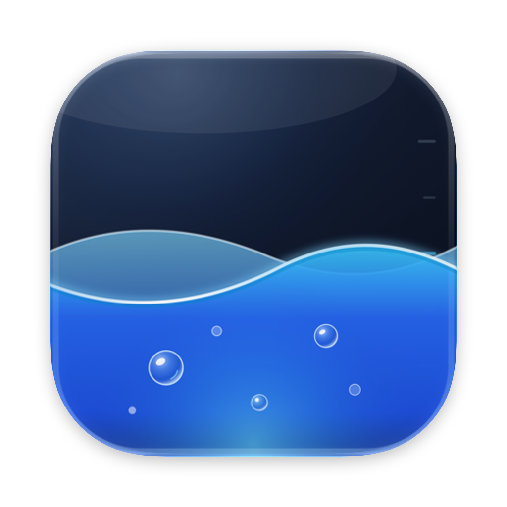
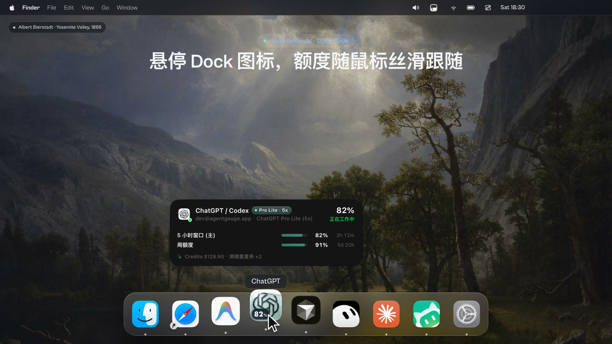
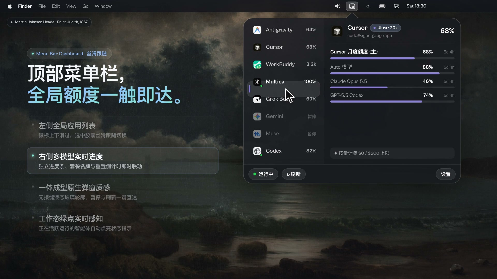
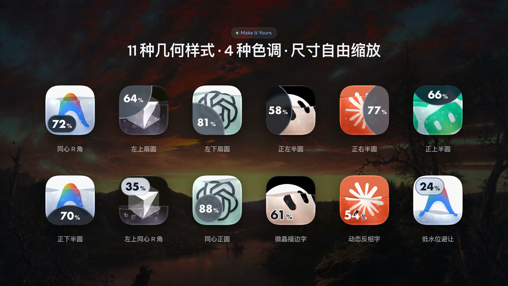
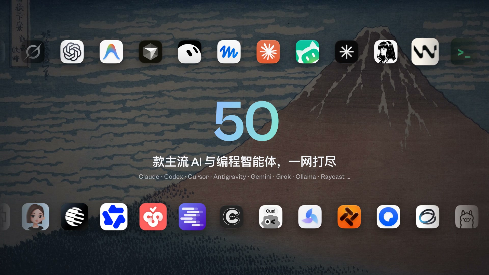

<div align="center">
  
  <h1>AgentGauge</h1>
  <p>
    <strong>Your AI quota, as clear as water.</strong><br />
    Turns every AI app and coding agent in your Mac's Dock into a living Metal liquid gauge — with 120Hz hover cards and a unified menu bar dashboard.
  </p>

  <p>
    <a href="https://github.com/HazelKahlil/AgentGauge/releases/latest"></a>
    
    
    
    <a href="./LICENSE"></a>
  </p>

  <p>
    <strong>English</strong> · <a href="./README.zh-CN.md">简体中文</a> · <a href="https://usage.komorebi.date">Official Website</a> · <a href="https://usage.komorebi.date/#lab">Live WebGL Lab</a> · <a href="https://github.com/HazelKahlil/AgentGauge/releases/latest">Releases</a>
  </p>

  <br />
  <a href="https://usage.komorebi.date">
    
  </a>
</div>

<br />

## Why AgentGauge?

Stop opening five different apps and settings pages just to discover you are out of credits mid-session. **AgentGauge** places your remaining quota right where your eyes already rest — **the macOS Dock and the menu bar**.

Hover any AI app in your Dock and its icon comes alive as a 16-bit half-float Metal water surface: waves sway with cursor inertia, micro-bubbles refract underneath, the percentage badge cuts its own optical contrast across the waterline, and a native Liquid Glass card glides smoothly alongside your pointer with per-model windows, subscription tier, and reset countdowns. Move your cursor away, and AgentGauge goes completely still (`0%` idle CPU/GPU).

---

## Visual Overview

<table>
  <tr>
    <td width="50%" valign="top">
      
      <p><strong>120Hz Gliding Hover Cards</strong><br />Plan tier badge, primary window, weekly quota, and per-model bars in one native Liquid Glass card. Progress bars automatically shift to amber below <code>30%</code> and red below <code>15%</code>.</p>
    </td>
    <td width="50%" valign="top">
      
      <p><strong>Unified Menu Bar Dashboard</strong><br />Click the wave icon in your menu bar to inspect every monitored app on the left and its full model breakdown on the right. Sweep vertically to switch apps instantaneously.</p>
    </td>
  </tr>
  <tr>
    <td width="50%" valign="top">
      
      <p><strong>11 Shapes · 4 Tones · Low-Water Dodge</strong><br />Every badge matches the exact squircle curvature of macOS icons. Below <code>30%</code>, concentric R-corner badges automatically glide to the upper corner so they never obscure the app glyph.</p>
    </td>
    <td width="50%" valign="top">
      
      <p><strong>50 AI Apps · One Gauge</strong><br />Coding agents, IDEs, JetBrains IDEs, and desktop/local AI assistants — discovered automatically via their macOS bundle identifiers and existing local sign-in state.</p>
    </td>
  </tr>
</table>

---

## Installation

### Download Installer (`.dmg`)

- **GitHub Releases (Primary)**: [**AgentGauge-v1.1.0-macOS.dmg**](https://github.com/HazelKahlil/AgentGauge/releases/latest/download/AgentGauge-v1.1.0-macOS.dmg) (`3.0 MB`, Universal / Apple Silicon)
- **Official Website Mirror (Fast Global / China CDN)**: [**usage.komorebi.date/downloads/AgentGauge-v1.1.0-macOS.dmg**](https://usage.komorebi.date/downloads/AgentGauge-v1.1.0-macOS.dmg)

1. Open `AgentGauge-v1.1.0-macOS.dmg` and drag **AgentGauge** into `/Applications`.
2. Launch **AgentGauge** and grant **Accessibility** permission when macOS prompts once (used solely to detect which Dock icon sits under your cursor).
3. *(Optional)* If macOS Gatekeeper displays an unverified developer prompt on first launch, run the following command in Terminal or click **Open Anyway** in **System Settings → Privacy & Security**:
   ```bash
   xattr -cr /Applications/AgentGauge.app
   ```

### Build from Source

Requires **macOS 26 Tahoe+** (SDK 14+ compatible build target) and **Swift 6.0 / Xcode Command Line Tools**:

```bash
git clone https://github.com/HazelKahlil/AgentGauge.git
cd AgentGauge

# Build Release binary & install to /Applications/AgentGauge.app
./Scripts/build_app.sh

# Package a distributable DMG in Website/downloads/
./Scripts/package_dmg.sh
```

---

## Supported Apps (50)

| Category | Applications |
| :--- | :--- |
| **Coding Agents & IDEs (18)** | Claude, ChatGPT / Codex, Cursor, Antigravity, Grok Bot, Muse, WorkBuddy, Multica, Hermes, Windsurf, Trae, Kiro, Zed, VS Code, Warp, Qoder, Devin, Xcode |
| **JetBrains & Terminal (5)** | IntelliJ IDEA, PyCharm, WebStorm, Android Studio, OpenCode |
| **AI Assistants & Local Runtimes (27)** | Gemini, Grok, DeepSeek, Perplexity, Doubao, Kimi, Qwen, Cherry Studio, LM Studio, ChatCut, Manus, Kaze, Tabbit, Quark, ChatGLM, Ollama, Raycast AI, Jan, Le Chat, Poe, Chatbox, LobeChat, AnythingLLM, NextChat, Open WebUI, GPT4All, ComfyUI |

---

## Privacy, Permissions & Architecture

AgentGauge is architected to be **100% local and auditable**:

| Concern | How AgentGauge Handles It | Source Reference |
| :--- | :--- | :--- |
| **No Cloud Sync or Telemetry** | Zero AgentGauge accounts, zero analytics SDKs, and zero remote servers. Quota data stays on your Mac. | `Sources/AgentGaugeCore/Providers/` |
| **Why Accessibility Permission?** | Used exclusively via `AXUIElement` hit-testing to identify which Dock icon your cursor hovers over. Never reads screen contents, keystrokes, or other app windows. | `Sources/AgentGaugeCore/AgentGaugeStore.swift` |
| **Non-Destructive Dock Overlays** | Liquid frames are live GPU overlays (`~1.7 ms`/frame on Metal), never permanent edits to `.app` bundles. Quit AgentGauge and every icon restores immediately; `AgentGaugeCleanup` guards against unexpected termination. | `Sources/CNativeDockTile/` · `Sources/AgentGaugeCleanup/` |
| **Zero Cost at Rest** | Rendering runs strictly while hovering the Dock. Move your pointer away and the render loop suspends completely. | `Sources/AgentGaugeCore/` |

---

## Repository Structure

```text
AgentGauge/
├── Sources/
│   ├── CNativeDockTile/      # Low-level macOS Dock tile bridge
│   ├── AgentGaugeCore/       # 16-bit half-float Metal shader, store & 50 app providers
│   ├── AgentGaugeApp/        # MenuBarPopoverView, HoverTooltipPanel & Settings workbench
│   ├── AgentGaugeCleanup/    # Crash-safe Dock icon restoration daemon
│   └── AgentGaugeProbe/      # CLI diagnostics & tile verification tool
├── Website/                  # Bilingual product site & WebGL shader port (usage.komorebi.date)
├── Promo/                    # Remotion 62s 1080p product film project
└── Scripts/                  # Release app bundler (build_app.sh) & DMG packager (package_dmg.sh)
```

---

## License

Released under the [MIT License](./LICENSE).  
All third-party product names, logos, and trademarks belong to their respective owners.
