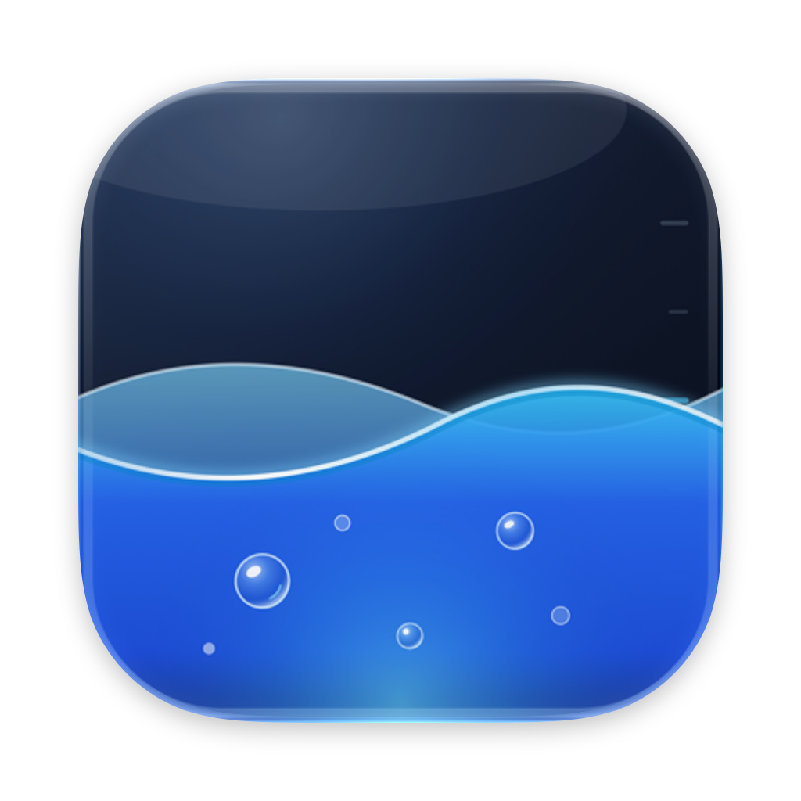
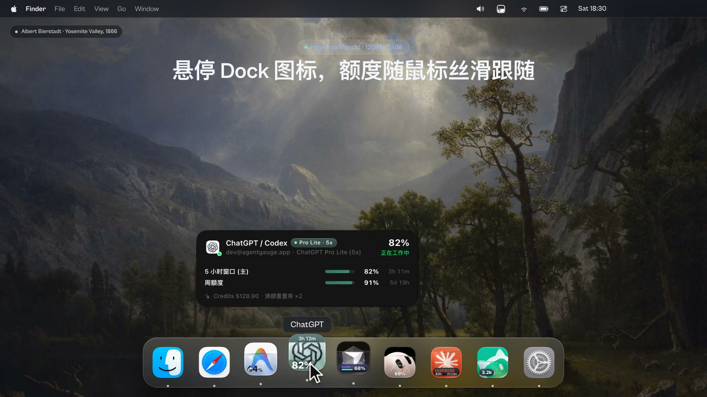
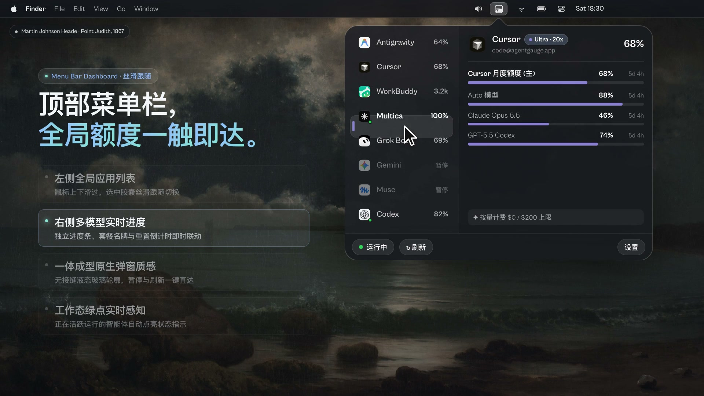
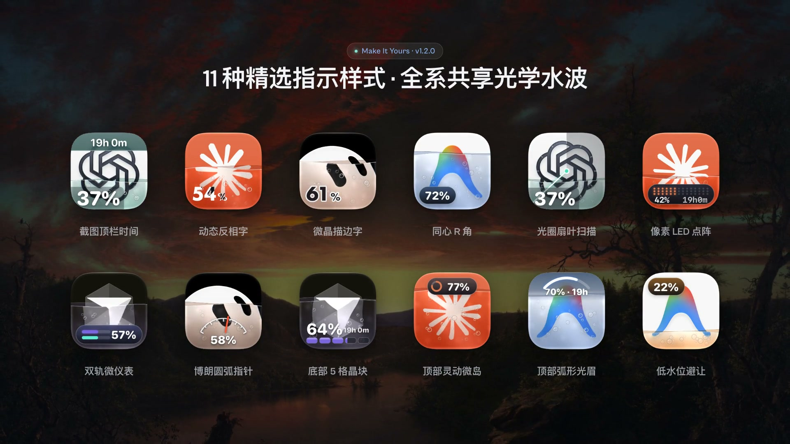
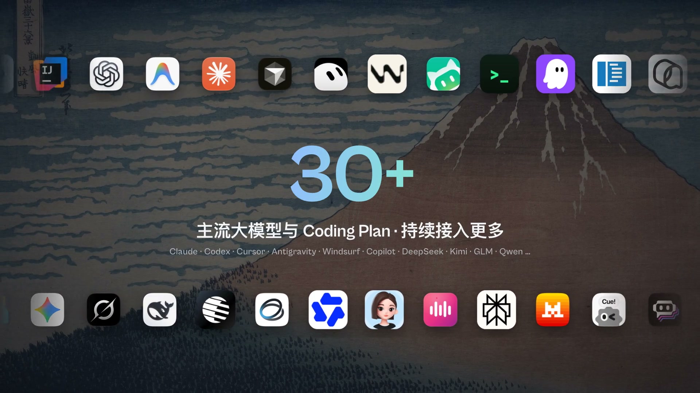

<div align="center">
  
  <h1>AgentGauge</h1>
  <p>
    <strong>AI 额度，清澈如水。</strong><br />
    将 Mac Dock 里的每一款 AI 应用与编程智能体，变成一枚实时流动的原生 Metal 液态仪表——悬停即见分模型余量，顶部菜单栏全局一触即达。
  </p>

  <p>
    <a href="https://github.com/HazelKahlil/AgentGauge/releases/latest"></a>
    
    
    
    <a href="./LICENSE"></a>
  </p>

  <p>
    <a href="./README.md">English</a> · <strong>简体中文</strong> · <a href="https://usage.komorebi.date/?lang=zh">产品官网</a> · <a href="https://usage.komorebi.date/?lang=zh#changelog">更新日志</a> · <a href="https://github.com/HazelKahlil/AgentGauge/releases/latest">下载安装包</a>
  </p>

  <br />
  <a href="https://usage.komorebi.date/?lang=zh">
    
  </a>
</div>

<br />

## 为什么做 AgentGauge？

别再挨个点开五六个应用和网页后台，才在写代码写到一半时发现额度早已见底。**AgentGauge** 把所有 AI 工具的剩余配额，放在你目光本就停留的地方——**macOS 的 Dock 栏与顶部菜单栏**。

鼠标轻轻掠过 Dock 上的 AI 应用图标，16 位半精度 Metal 管线即刻唤醒双层液态水面：波浪随指针惯性轻晃，微泡在水下折射微光，百分比数字穿过水线时自动完成光学反相，上方液态玻璃卡片以 120Hz 丝滑跟随鼠标，一眼看清订阅套餐、5 小时/周限额、各模型独立进度与重置倒计时。移开鼠标，渲染即刻休眠，闲置占用严格归零。

---

## 核心体验一览

<table>
  <tr>
    <td width="50%" valign="top">
      
      <p><strong>120Hz 悬停卡片 · 分模型明细</strong><br />订阅等级徽章（AI Ultra / Pro Lite · 5x / Max 20x 等）、主窗口额度、周限额与各模型独立进度条收进同一张原生液态玻璃卡片。低于 <code>30%</code> 自动转琥珀色预警，低于 <code>15%</code> 亮红提醒。</p>
    </td>
    <td width="50%" valign="top">
      
      <p><strong>菜单栏里的全局看板</strong><br />点击系统顶部菜单栏的水位图标，左侧纵览全部已监控应用与活跃绿点，右侧实时联动多模型进度条，鼠标上下滑过即可丝滑切换，支持单应用独立暂停与一键刷新。</p>
    </td>
  </tr>
  <tr>
    <td width="50%" valign="top">
      
      <p><strong>11 种精选样式 · 全系光学水波</strong><br />涵盖截图顶栏时间、动态极性反相字、光圈扇叶扫描、像素 LED 点阵、博朗圆弧指针与低水位避让——统一搭载招牌微泡折射液态着色器。</p>
    </td>
    <td width="50%" valign="top">
      
      <p><strong>30+ 主流模型与套餐 · 持续扩展更多</strong><br />聚焦拥有真实订阅配额、Coding Plan 积分或官方 API 余额池的自研大模型与智能体，持续接入更多主流厂商。</p>
    </td>
  </tr>
</table>

---

## v1.2.1 更新亮点（完整记录见 [CHANGELOG.md](./CHANGELOG.md)）

- **Dock 相邻图标缝隙零闪烁施密特防抖（`v1.2.1`）**：重构单一权威 60Hz `DockAXHitOutcome` 五态分类状态机，引入 `3.8–5.5pt` 施密特触发器迟滞死区（双向约 `17pt`）与空隙保持带，彻底消除开启 Dock 放大时鼠标停在两图标交界或缝隙处的来回闪烁跳变。
- **11 款纯图标精选指示样式 + 统一光学水波**：定制「截图顶栏时间、动态反相字、微晶描边字、同心 R 角避让、光圈扇叶扫描、像素 LED 点阵、双轨微仪表、博朗圆弧指针、底部 5 格晶块、顶部灵动微岛、顶部弧形光眉」，全系共享招牌微泡折射水波与浅色图标低水位自适应增强。
- **重力稳态 120Hz 水波物理与悬停水平导轨**：消除异步位移抖动，升级临界阻尼水面恢复，左右横滑时悬停卡片严格沿水平导轨丝滑平移、绝不上下跳动。
- **30+ 主流模型与套餐直连 & API 余额一等公民**：聚焦真实订阅与计费厂商并持续扩展；新增 DeepSeek / Kimi 官方货币余额池（如 `¥28.50`）、GitHub Copilot、Windsurf 本地状态与 Antigravity `AI Ultra` 套餐等级自动识别。
- **合盖休眠零功耗与自愈式底层防护**：新增系统睡眠/锁屏自动挂起、Dock 图块 Mach 通道 5 秒断路自愈及子进程确定性回收。

---

## 下载与安装

### 方式一：直接下载安装包（`.dmg`）

- **官网全球 / 国内高速直链（Cloudflare CDN 推荐）**：[**AgentGauge-v1.2.1-macOS.dmg**](https://usage.komorebi.date/downloads/AgentGauge-v1.2.1-macOS.dmg)（`2.7 MB`）
- **GitHub Releases 下载**：[**AgentGauge-v1.2.1-macOS.dmg**](https://github.com/HazelKahlil/AgentGauge/releases/latest/download/AgentGauge-v1.2.1-macOS.dmg)

1. 打开 `AgentGauge-v1.2.1-macOS.dmg`，将 **AgentGauge** 拖入 `/Applications`（应用程序）文件夹。
2. 首次启动时按系统提示授予一次 **辅助功能（Accessibility）** 权限（仅用于判断鼠标当前悬停在哪个 Dock 图标上）。
3. *(可选)* 若首次打开时遇到 macOS Gatekeeper 开发者验证提示，可在「系统设置 → 隐私与安全性」中点击**仍要打开**，或在终端执行：
   ```bash
   xattr -cr /Applications/AgentGauge.app
   ```

### 方式二：从源码编译

环境要求：**macOS 26 Tahoe 或更新版本**，已安装 **Swift 6.0 / Xcode Command Line Tools**：

```bash
git clone https://github.com/HazelKahlil/AgentGauge.git
cd AgentGauge

# 编译 Release 版本并安装至 /Applications/AgentGauge.app
./Scripts/build_app.sh

# 打包可分发的 DMG 安装镜像（输出至 Website/downloads/）
./Scripts/package_dmg.sh
```

---

## 已支持的主流模型与套餐厂商（30+ 持续扩展）

| 类别 | 支持厂商与官方客户端 |
| :--- | :--- |
| **Coding Agent & AI IDE** | ChatGPT / Codex, Antigravity, Claude, Cursor, Grok Bot, Windsurf, WorkBuddy, Trae, Kiro, VS Code (Copilot), Qoder, Zed, Warp, Devin, IntelliJ IDEA, PyCharm, WebStorm |
| **自研大模型 · 官方套餐与 API** | Gemini, Grok, DeepSeek, Kimi, 智谱 GLM, 通义千问 Qwen, 豆包 Doubao, MiniMax, Perplexity, Le Chat (Mistral), Manus, Poe —— *持续接入更多主流厂商* |

---

## 隐私边界与架构审计

AgentGauge 从底层设计上坚持 **100% 本地运行、源码完全可审计**：

| 安全关切 | AgentGauge 的实现边界 | 对应源码路径 |
| :--- | :--- | :--- |
| **零云端同步 · 零遥测上报** | 无需注册 AgentGauge 账号，不接入任何第三方统计 SDK，不向任何外部服务器上传配额或凭证。 | `Sources/AgentGaugeCore/Providers/` |
| **为什么需要辅助功能权限？** | 仅通过 `AXUIElement` 检测鼠标当前悬停在哪个 Dock 图标上；绝不读取屏幕画面、键盘输入或其他窗口内容。 | `Sources/AgentGaugeCore/AgentGaugeStore.swift` |
| **绝不永久修改应用图标** | 液态水位为实时 GPU 图块叠加层（Metal 单帧约 `1.7 ms`），不改动原 `.app` 包内资源；退出即刻复原，并内置 `AgentGaugeCleanup` 守护进程防止异常退出残留。 | `Sources/CNativeDockTile/` · `Sources/AgentGaugeCleanup/` |
| **离开视线即零占用** | 仅在指针悬停 Dock 时运行渲染循环；鼠标移开后立即挂起休眠。 | `Sources/AgentGaugeCore/` |

---

## 目录结构

```text
AgentGauge/
├── Sources/
│   ├── CNativeDockTile/      # macOS 原生 Dock 图块底层桥接
│   ├── AgentGaugeCore/       # 16-bit 半精度 Metal 液态着色器、状态存储与 30+ 厂商 Provider
│   ├── AgentGaugeApp/        # 菜单栏全局看板 (MenuBarPopoverView)、悬停卡片与设置工作台
│   ├── AgentGaugeCleanup/    # 崩溃安全的原生 Dock 图标自动还原守护进程
│   └── AgentGaugeProbe/      # 命令行诊断与图块渲染校验工具
├── Website/                  # 中英双语产品官网与 WebGL 实时液态着色器移植版 (usage.komorebi.date)
├── Promo/                    # Remotion 62 秒 1080p 产品宣传片工程
└── Scripts/                  # Release 构建脚本 (build_app.sh) 与 DMG 打包脚本 (package_dmg.sh)
```

---

## 开源协议

本项目基于 [MIT License](./LICENSE) 开源发布。  
文中提及的所有第三方产品名称、商标与应用图标均归其各自所有者所有。
